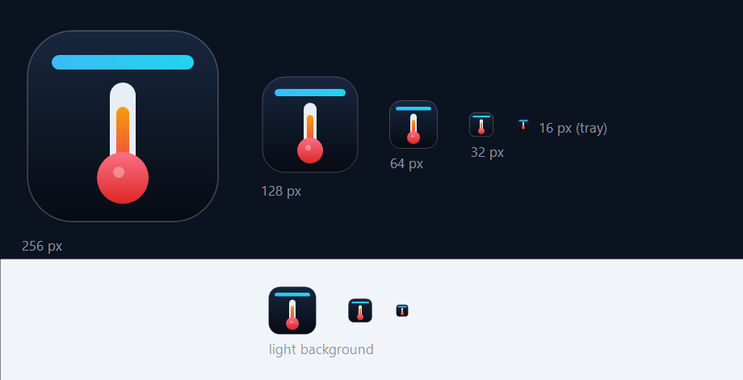

<p align="center">
  
</p>

<h1 align="center">盘温</h1>

<p align="center">Windows 顶部硬盘温度悬浮条 · 游戏时也能一眼看到 SSD 温度</p>

盘温（内部代号 SsdTempHud）是一款常驻 Windows 桌面的轻量悬浮工具，在屏幕顶部显示每块内置硬盘的**实时温度**和**磁盘活动率**。它不占任务栏、不抢焦点、支持鼠标穿透，适合在游戏或无边框全屏应用中查看硬件状态。

> 当前版本：**v0.2.0（开发中）**，真实温度与活动率已接入。

## 功能

- **实时温度**：读取 NVMe 硬盘的复合温度，按阈值变色（正常 / 偏高 / 危险）。
- **磁盘活动率**：每秒刷新，和任务管理器「性能 → 磁盘」的趋势一致。
- **顶部悬浮条**：无边框、始终置顶、不显示在任务栏、不抢焦点。
- **点击穿透**：默认开启，鼠标点击直接落到游戏；`Ctrl+Alt+M` 可切换。
- **托盘与设置窗口**：设置窗口是普通窗口，会出现在任务栏和 `Alt+Tab` 中。
- **透明度调节**：0%–100% 实时生效，0% 时只显示文字。
- **多盘同屏**：按物理磁盘排列，显示盘符、温度、活动率。

## 界面

```text
┌──────────────────────────────────────────────────────────────────┐
│  ● C: D:  51°C  ███░░  12%    │    ● E: F:  58°C  █░░░░   3%   │
└──────────────────────────────────────────────────────────────────┘
```

界面示意可下载 [`docs/ui-mockup.html`](docs/ui-mockup.html) 后用浏览器打开。实际界面由 WPF 绘制。

## 系统要求

- Windows 10 2004+ 或 Windows 11，x64
- .NET Framework 4.8（Windows 自带，无需安装）
- **管理员权限**：读取硬盘温度必须提权，程序清单已声明 `requireAdministrator`
- 目前温度通道仅支持 **NVMe** 内置硬盘；SATA 温度读取尚未实现

## 快速开始

### 方式一：下载 Release

在 [Releases](../../releases) 页面下载最新 `SsdTempHud.exe`，双击运行并允许 UAC 提权。

### 方式二：从源码构建

无需安装 .NET SDK，使用系统自带的 C# 编译器：

```cmd
build.cmd
bin\SsdTempHud.exe
```

构建脚本会调用 `%WINDIR%\Microsoft.NET\Framework64\v4.0.30319\csc.exe`，并把应用清单与图标嵌入 exe。

## 使用

| 操作 | 说明 |
|---|---|
| `Ctrl+Alt+H` | 显示 / 隐藏横条 |
| `Ctrl+Alt+M` | 切换点击穿透 |
| 托盘图标右键 | 设置、显示/隐藏、点击穿透、透明度、退出 |
| 托盘图标双击 | 打开设置窗口 |
| 设置窗口 | 拖动滑块调节背景不透明度（0%–100%） |

## 技术实现

| 数据 | 来源 |
|---|---|
| 温度 | `DeviceIoControl` + `IOCTL_STORAGE_QUERY_PROPERTY`（`StorageDeviceTemperatureProperty`） |
| 活动率 | `PerformanceCounter("PhysicalDisk", "% Disk Time", instance)` |
| 型号 / 盘符 | WMI `MSFT_Disk`，失败时回退 `Win32_DiskDrive` |
| 界面 | C# 5 + WPF（.NET Framework 4.8），代码构建，无 XAML |

设计要点：

- 采集全部在后台线程，UI 只渲染快照；
- 不加载第三方内核驱动、不注入游戏进程、不联网；
- 单块盘读取失败只影响该项，显示 `--` 并自动重试。

## 项目结构

```text
ssd-temp-hud/
├─ src/                  源码
│  ├─ Sensors/           温度、活动率、磁盘元数据
│  ├─ HudWindow.cs       顶部悬浮条
│  ├─ SettingsWindow.cs  设置窗口
│  └─ ...
├─ docs/                 需求、设计、品牌与界面示意
├─ tools/                图标生成、硬件探测、传感器自测
├─ app.manifest          提权与 DPI 声明
├─ app.ico               应用图标
├─ build.cmd             编译脚本
└─ run.cmd               启动脚本
```

## 已知限制

- **独占全屏（Exclusive Fullscreen）下可能看不到横条**：普通置顶窗口无法覆盖 DirectX 独占全屏，建议游戏使用「无边框窗口 / 窗口化全屏」。
- **仅支持 NVMe 温度**：SATA 硬盘需要额外的 SMART 读取通道，尚未实现。
- **必须管理员运行**：每次启动会弹 UAC；开机自启方案在路线图中。
- **配置暂未持久化**：透明度、穿透状态等重启后恢复默认（M3 计划）。
- 0% 透明度时，浅色游戏画面上文字对比度可能不足。

## 路线图

- [x] M1：悬浮条 UI、置顶、穿透、托盘、热键
- [x] M2：真实温度与活动率、管理员提权、中文名与图标
- [ ] M3：配置持久化、多显示器、开机自启
- [ ] M4：安装包 / 单文件发布、8 小时长稳测试、使用说明

## 开发辅助

```cmd
:: 重新生成图标（app.ico + 预览图）
powershell -NoProfile -ExecutionPolicy Bypass -File tools\make-icon.ps1

:: 硬件能力探测（需管理员，会生成含序列号的本地报告，已被 git 忽略）
tools\run-probe.cmd

:: 无界面传感器自测（编译 tools/SensorProbe/Program.cs 后运行）
```

## 许可证

[MIT](LICENSE)

## 免责声明

本工具只读访问硬盘信息，不修改磁盘、不安装驱动、不联网。温度数据来自硬盘厂商与 Windows 存储栈，仅供参考；因使用本工具造成的任何损失，作者不承担责任。
